<div align="center">

# 🥊 CLOUT CLASH

### The Influencer Fighting Championship

**A Tekken-inspired 2D browser fighting game where six parody influencers battle with superpowers drawn from their content niche.**

[](https://atharvkmore.github.io/clout-clash/)
[](https://raw.githubusercontent.com/atharvkmore/clout-clash/main/index.html)


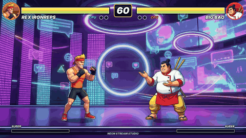

</div>

---

## ✨ Highlights

- **6 playable fighters**, each a parody of an influencer niche, with a unique special move and a cinematic super
- **3 modes**: Arcade (5-match ladder with rising AI difficulty), 2-player local Versus, and CPU-vs-CPU demo
- **Real fighting-game systems**: punch chains → launcher, air attacks, juggles, guarding with chip damage, hit-stop, combo damage scaling, super meter
- **3 stages**, AI-generated character art, music and announcer voice
- **One HTML file, no install, no internet**: every sprite, background, track and voice line is embedded
- **Plays on touch screens**: on-screen buttons appear on first tap

## 🎮 Play

| Option | How |
|---|---|
| **In the browser** | Open **[atharvkmore.github.io/clout-clash](https://atharvkmore.github.io/clout-clash/)** |
| **Offline** | Download [`index.html`](https://raw.githubusercontent.com/atharvkmore/clout-clash/main/index.html) (right-click → *Save link as…*), then double-click it |

### Controls

| Action | Player 1 | Player 2 |
|---|---|---|
| Move | `A` / `D` | `←` / `→` |
| Jump | `W` | `↑` |
| Guard | `S` (or hold back) | `↓` (or hold back) |
| Punch | `F` | `J` |
| Kick | `G` | `K` |
| Special power | `H` | `L` |
| Super (meter full) | `R` | `I` |

`Esc`/`P` pause · `M` mute · In 1-player modes both key sets control Player 1.

**Combos:** `Punch, Punch, Punch` chains into a launcher · a kick cancels a landed punch · `Jump + Punch/Kick` = air kick · hits on an airborne rival juggle.

## 🧑‍🤝‍🧑 Roster

| | Fighter | Niche | HP | Speed | Special | Super |
|---|---|---|---|---|---|---|
| 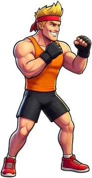 | **Rex Ironreps** | Fitness | 112 | ●●○○ | Protein Shot: thrown shaker bottle | **Leg Day**: arena-wide ground slam that launches |
| 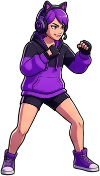 | **Kira Framerate** | Gaming | 96 | ●●●● | Pixel Blast: fast pixel projectile | **Rage Quit**: three tracking lightning strikes |
|  | **Big Bao** | Mukbang | 136 | ●○○○ | Chili Breath: close-range fire stream | **Noodle Tsunami**: giant noodle wave |
| 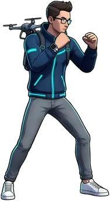 | **Dev Gadget** | Tech reviews | 100 | ●●●○ | Phone Laser: instant full-screen beam | **Drone Strike**: drone drops 4 bombs |
|  | **Lady Contour** | Beauty | 96 | ●●●○ | Lipstick Missile: homing rocket | **Glitter Storm**: screen-wide multi-hit storm |
| 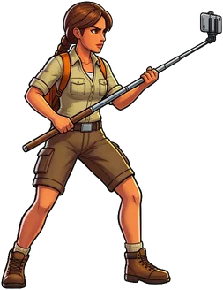 | **Wanda Lust** | Travel vlogs | 102 | ●●●○ | Flash!: camera flash that stuns | **First Class**: a jet flies through the arena |

All characters are original parodies of content *niches*. None depicts or is affiliated with a real person.

## 📸 Screenshots

| Title | Character select |
|---|---|
| 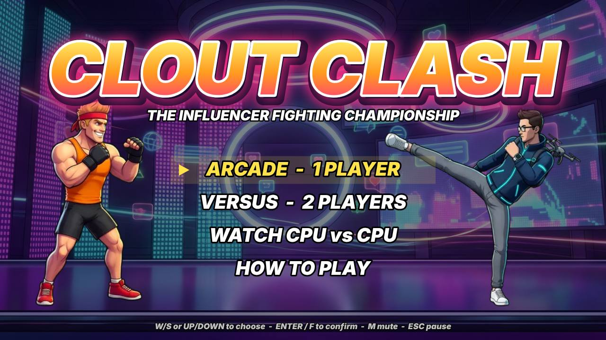 | 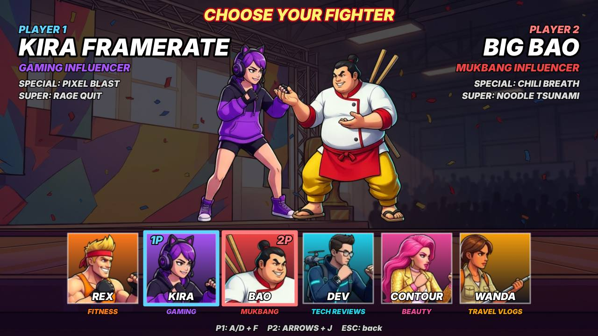 |
| **Special move** | **Super move** |
| 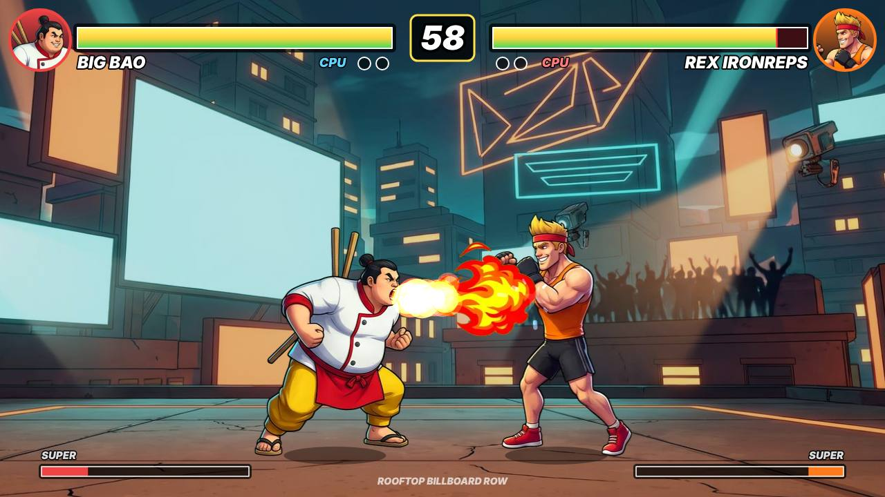 | 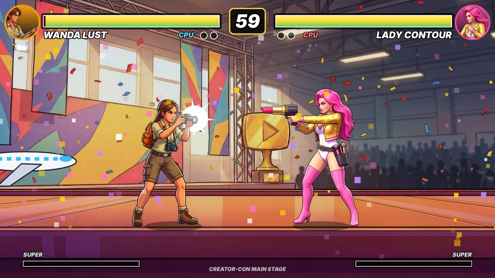 |
| **Versus screen** | **How to play** |
| 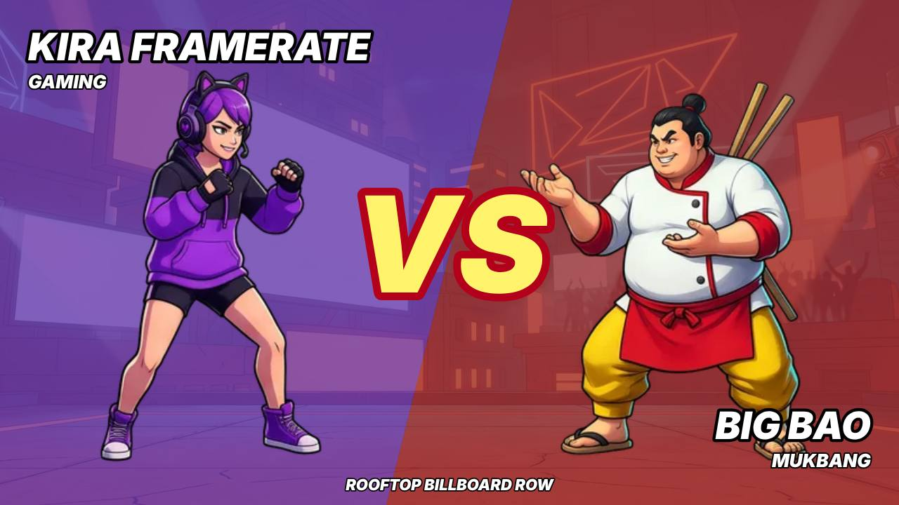 | 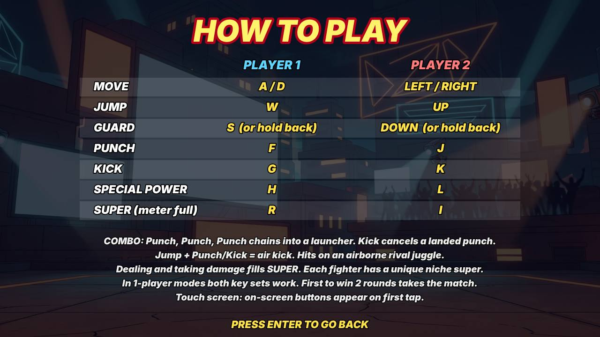 |

## 🗺️ Project mindmap

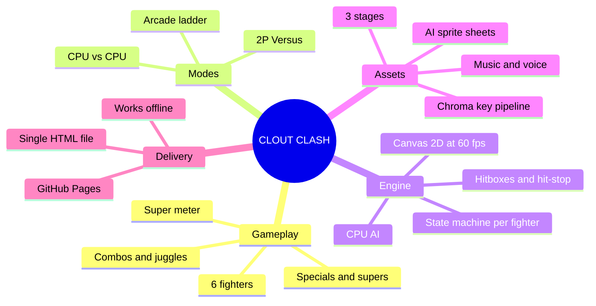

Full illustrated version: **[docs/MINDMAP.md](docs/MINDMAP.md)**

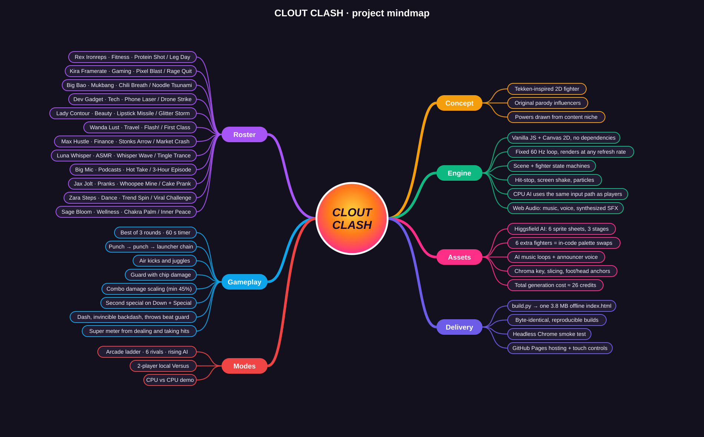

## 🛠️ Build from source

```bash
git clone https://github.com/atharvkmore/clout-clash
cd clout-clash
python3 tools/build.py        # embeds src/ + assets/ into index.html
```

Needs only Python 3 (standard library). The output is byte-for-byte identical to the published game. Details are in **[docs/BUILD_AND_DEPLOY.md](docs/BUILD_AND_DEPLOY.md)**.

```bash
npm install --no-save playwright-core
CHROME=/path/to/chrome node tests/smoke_test.js   # menus, input, all supers, 6 full matches
```

## 📁 Repository layout

```
clout-clash/
├── index.html              ← the built game (served by GitHub Pages)
├── src/
│   ├── game.js             ← engine: loop, fighters, combat, AI, rendering, audio, UI
│   └── template.html       ← page shell (canvas, touch controls, CSS)
├── assets/
│   ├── manifest.json       ← sprite anchors, stage floor lines, audio list
│   ├── sprites/<fighter>/  ← 8 poses per fighter (WebP, transparent)
│   ├── stages/             ← 3 backgrounds (JPEG)
│   └── audio/              ← music/ and voice/ (MP3)
├── tools/
│   ├── build.py            ← bundles everything into index.html
│   ├── process_sprites.py  ← chroma key + slice AI sprite sheets
│   ├── process_stages.py   ← resize backgrounds, set floor lines
│   ├── process_audio.sh    ← trim, normalize and compress audio
│   └── make_mindmap.py     ← draws docs/mindmap.svg
├── tests/smoke_test.js     ← headless Chromium test
└── docs/                   ← guides, mindmap, screenshots
```

## 📚 Documentation

| Guide | What's inside |
|---|---|
| [Gameplay](docs/GAMEPLAY.md) | Rules, every move with damage/frame data, meter, combos, AI behaviour |
| [Architecture](docs/ARCHITECTURE.md) | Game loop, scene flow, fighter state machine, combat resolution, rendering, audio |
| [Asset pipeline](docs/ASSET_PIPELINE.md) | How the art and audio were generated with AI and processed, with prompts and costs |
| [Build & deploy](docs/BUILD_AND_DEPLOY.md) | Building, testing, GitHub Pages hosting, adding a new fighter |
| [Mindmap](docs/MINDMAP.md) | Visual overview of the whole project |

## 🙌 Credits

- **Design, code and direction:** [Atharv kiran more](https://github.com/atharvkmore)
- **Character art and stages:** generated with [Higgsfield](https://higgsfield.ai) (Nano Banana image models)
- **Music:** ElevenLabs Music v2 via Higgsfield · **Announcer:** Seed Audio 1.0 via Higgsfield
- **Sound effects:** synthesized at runtime with the Web Audio API
- Built with AI assistance from Claude (Anthropic)

## 📄 License

[MIT](LICENSE) © 2026 Atharv kiran more
