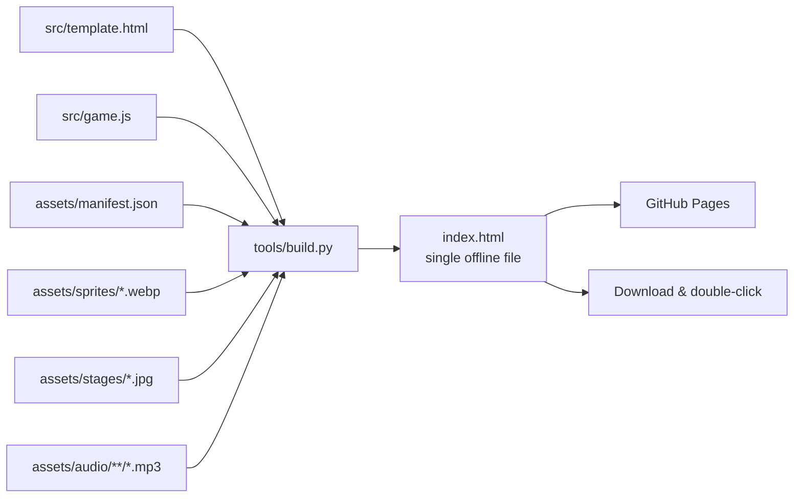
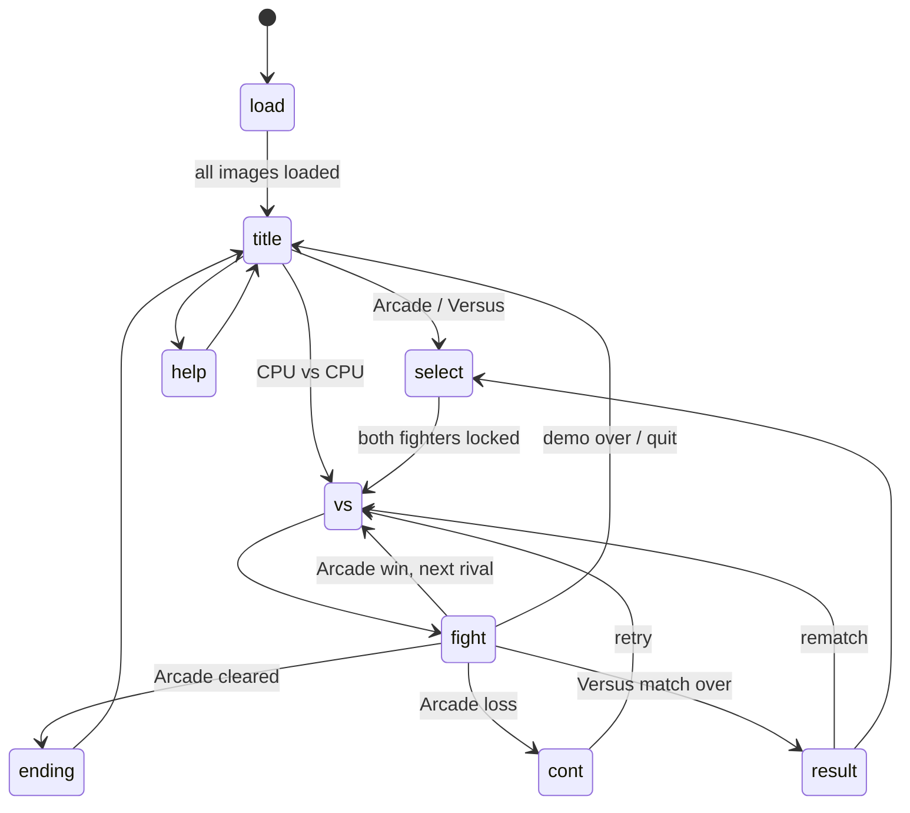
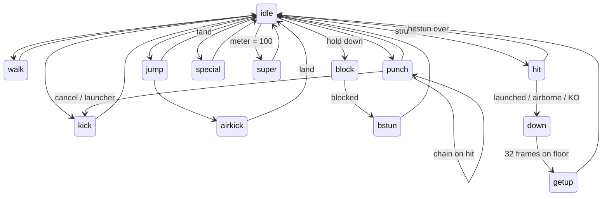

# Architecture

CLOUT CLASH is a dependency-free game: one JavaScript file ([`src/game.js`](../src/game.js), ~46 KB) drawing on one `<canvas>`, wrapped in a small HTML shell ([`src/template.html`](../src/template.html)). The build script inlines every asset as a base64 data URI, so the shipped [`index.html`](../index.html) needs no server and no network.



## Runtime layout

`game.js` is a single IIFE organised into sections, top to bottom:

| Section | Responsibility |
|---|---|
| **Constants & roster** | Canvas size (1280×720), world width (1700), the 6 fighter definitions (stats, move names, special/super kinds). |
| **Asset loading** | Turns every data URI in `window.ASSETS` into an `Image`, counts loads, then builds circular portrait cards from each fighter's head point. |
| **Audio** | Web Audio graph: master → music gain + SFX gain. Music and voice clips are decoded from data URIs; music loops seamlessly. All sound effects (hits, whooshes, lasers, explosions) are **synthesized** from oscillators and filtered noise, so they cost no file size. |
| **Input** | Keyboard map for two players, `pressed` (edge) vs `keys` (held) tracking, on-screen touch buttons created on first touch, and clickable "hot zones" for mouse/tap menu navigation. |
| **Scene state** | `load → title → select → vs → fight → result / cont / ending`, plus `help`. |
| **Combat** | Fighter state machine, melee hit detection, projectiles and super effects, damage, meter, knockdowns. |
| **AI** | `aiInput()` produces the same input object a human would, so CPU fighters go through exactly the same code path. |
| **Rendering** | Parallax stage, shadows, sprites with squash/bob/flash effects, entities, particles, HUD, banners, menus. |
| **Main loop** | Fixed-timestep loop driven by `requestAnimationFrame`. |

## Main loop

```js
acc += dt;                       // real time since last frame (capped at 100 ms)
while (acc >= 16.667 && n < 4) { // fixed 60 Hz simulation, max 4 catch-up steps
  step();                        // game logic for the current scene
  clear edge-triggered input;
  acc -= 16.667;
}
render();                        // draw once per display frame
```

Logic never depends on the display's refresh rate, so the game plays identically on 60 Hz and 144 Hz screens.

## Scene flow



Inside `fight`, a round moves through **phases**: `intro` (ROUND 1… FIGHT!) → `fight` → `ko` (slow motion) or time-up → `post` (winner banner) → next round or match end.

## Fighter state machine

Each fighter is a plain object (`x, y, vx, vy, face, hp, meter, st, t, …`). `st` is the current state and `t` counts frames spent in it.



Only `idle`, `walk` and `block` accept new commands, which gives attacks real commitment and recovery.

## Combat resolution

1. **Melee**: during an attack's active frames, `tryMelee()` checks horizontal distance against the move's reach (measured from the sprite itself: how far the extended fist/foot sits from the body anchor) plus the defender's body width, and checks vertical overlap for air attacks. Each attack can hit only once (`hitDone`).
2. **Projectiles & effects** live in an `ents` list (`proj`, `beam`, `ring`, `shock`, `bolt`, `drone`, `bomb`, `storm`), each updated per frame with its own collision rule.
3. **`hit()`** applies everything in one place: invincibility checks, guard (chip damage, blockstun), combo scaling, meter gain, hit-stop, screen shake, sparks, knockback, and the transition to `hit` / `down` / K.O.
4. **Push boxes** stop fighters overlapping, and a separation clamp keeps both on screen. The camera follows the midpoint.

## Rendering

- **Stage**: a wide background scrolled with parallax as the camera moves; the floor line (`g` in the manifest) sets where feet stand.
- **Sprites**: each frame is drawn from its foot anchor (`ax`), flipped by facing direction. Animation comes from cycling poses (walk alternates *idle/walk*) plus procedural touches: idle breathing, walk bob, hit shake, a white hit-flash (additive blend), a pulsing glow during supers, and a blinking alpha while invincible.
- **Effects**: particles (sparks, fire, dust, glitter) and all projectiles are drawn with Canvas primitives, not images.
- **HUD**: health bars with a delayed red "damage" bar, round-win pips, super meters, combo counter, timer and portraits.
- **Resolution**: the canvas renders at 1280×720 and CSS scales it to fit any screen at 16:9.

## Testing hook

`window.__cc` exposes read-only info and a few test helpers (`info()`, `start()`, `stepN()`, `meter()`, …). [`tests/smoke_test.js`](../tests/smoke_test.js) uses it to run the simulation faster than real time in headless Chromium.
