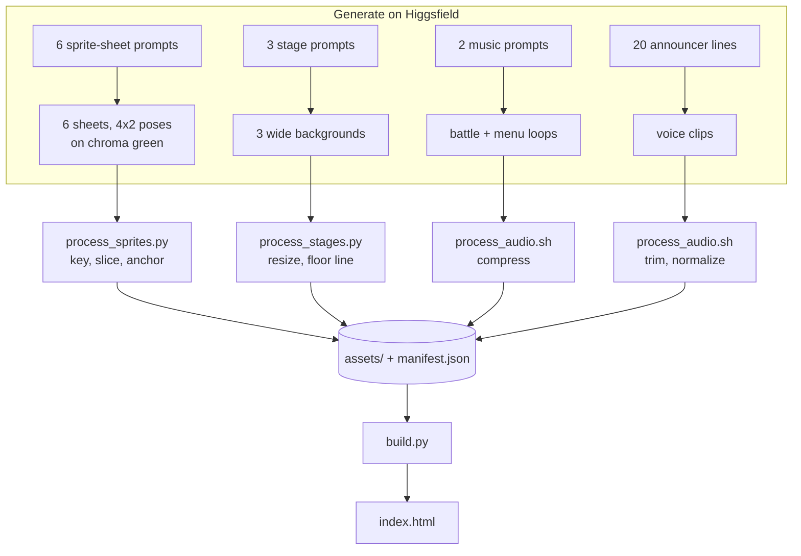

# Asset pipeline

All character art, stages, music and announcer lines were generated with AI on [Higgsfield](https://higgsfield.ai) on a tight budget, then processed by the scripts in [`tools/`](../tools). Sound effects are synthesized in the browser and cost nothing.

## Budget

| Item | Model | Count | Approx. credits |
|---|---|---|---|
| Fighter sprite sheets (2K, 16:9) | Nano Banana image model | 6 | 12 |
| Stage backgrounds (2K, 21:9) | Nano Banana image model | 3 | 6 |
| Battle theme (64 s) + menu theme (32 s) | ElevenLabs Music v2 | 2 | ~6 |
| Announcer lines | Seed Audio 1.0 (preset voice "Desmond") | 20 | ~4 |
| Sound effects | Web Audio synthesis | ∞ | 0 |
| **Total** | | | **≈26 credits** |

Every asset came out usable on the first try, so no credits went to retries.

## 1. Sprite sheets

The key decision: generate each fighter as **one sheet with all 8 poses**, instead of 8 separate images. One generation keeps the character consistent across poses and costs one-eighth as much.

Prompt template (one per fighter; only the character description and pose details change):

> Fighting game character sprite sheet: 8 poses of the SAME character arranged in a clean grid of 4 columns x 2 rows, evenly spaced with wide gaps, poses never touching or overlapping, each pose full body head to toe fully visible, side view, character always facing RIGHT, identical scale in every cell. Character: *‹description›*. Top row: (1) idle fighting stance; (2) walking forward mid-step; (3) straight punch fully extended to the right; (4) high side kick fully extended. Bottom row: (5) special attack pose: *‹niche prop›*; (6) defensive block; (7) getting hit, recoiling; (8) knocked out, lying flat. Style: stylized 3D game character render, bold cel-shaded look, strong rim light, vivid colors, modern arcade fighting game roster art. Background: perfectly flat solid pure chroma green #00FF00, no floor, no shadows, no text, no grid lines. No green anywhere on the character.

| Fighter | Character description (abridged) | Special prop |
|---|---|---|
| Rex Ironreps | huge muscular fitness influencer, spiky blond hair, red headband, orange tank top | throwing a protein shaker |
| Kira Framerate | gaming streamer, short purple hair, cat-ear headset, esports hoodie | glowing game controller |
| Big Bao | big jolly food vlogger, top knot, chef jacket, red apron, giant chopsticks | breathing chili fire |
| Dev Gadget | tech reviewer, glasses, dark-blue techwear with cyan trim, drone on backpack | smartphone glowing like a weapon |
| Lady Contour | beauty guru, long hot-pink hair, gold sequin jacket, pink boots | giant lipstick blaster |
| Wanda Lust | travel vlogger, braided ponytail, khaki explorer outfit, selfie stick | camera flash burst |

**Processing** ([`tools/process_sprites.py`](../tools/process_sprites.py)):

1. **Chroma key**: alpha comes from how much greener a pixel is than its red/blue, with a soft edge between 25 and 75 for anti-aliased outlines. A despill pass caps green at max(red, blue) + 8, which removes the green halo.
2. **Slice**: connected blobs are found and assigned to grid cells by centre of mass, so imperfect AI spacing doesn't break the cut.
3. **Clean**: each cell keeps only its largest blob, except *special*, which keeps every blob so thrown props and fire effects survive.
4. **Anchor**: the body's centre of mass gives the foot anchor (`ax`). Attack poses take their anchor from the idle pose's back edge, so the fighter doesn't slide when a limb extends. The head point (`hx, hy`) feeds the portrait cards.
5. **Export**: half-resolution WebP (quality 82), about 20 KB per pose.

## 2. Stages

| Stage | Prompt idea | Floor line `g` |
|---|---|---|
| Neon Stream Studio | giant neon streamer studio, RGB LED walls, ring lights, holographic chat bubbles | 0.86 |
| Rooftop Billboard Row | night rooftop above a megacity, blank billboards, camera drones, distant crowd | 0.90 |
| Creator-Con Main Stage | expo-hall main stage, banners, confetti, golden play-button trophies | 0.80 |

All prompts ask for an empty arena, a flat floor in the bottom quarter, a perfectly horizontal floor line, and no text or logos. [`tools/process_stages.py`](../tools/process_stages.py) resizes each to 1700 px wide (wider than the 1280 px screen, which leaves room for parallax) and saves it as a JPEG.

## 3. Music and voice

- **Battle theme**: "High-energy arcade fighting game battle theme, 150 BPM, driving electronic rock with punchy drums, distorted synth bass, heroic lead synth melody… seamless loop, instrumental" (64 s)
- **Menu theme**: "Fighting game character select menu music, 110 BPM, cool confident synthwave groove with funky bass and bright arpeggios… seamless loop, instrumental" (32 s)
- **Announcer** (20 lines): *Clout Clash! · Choose your fighter! · Round one / two · Final round! · Fight! · Knockout! · Perfect! · You win! / You lose! · Player one / two wins!* plus each fighter's name.

[`tools/process_audio.sh`](../tools/process_audio.sh) re-encodes music at 104 kbps stereo. Voice clips get silence trimmed from both ends, loudness normalized to −14 LUFS, and are saved as 64 kbps mono.

## 4. Synthesized sound effects

`SFX` in `game.js` builds every effect from two primitives: `tone()` (an oscillator with a pitch sweep and decay) and `noise()` (filtered white noise with a swept cutoff). For example, a heavy hit is low-passed noise plus a 120→35 Hz sine "thump", and the laser is two saw/square sweeps from 1.8–2.4 kHz down. 15 distinct effects add 0 bytes of audio.

## Raw source files

The original full-resolution sheets and audio (`raw/`) aren't committed, to keep the repo small. The processed assets in `assets/` are the source of truth for building. To regenerate an asset, drop new raw files into `raw/` (sheets as `c0.png`…`c5.png`, stages as `s0.png`…`s2.png`, audio in `raw/audio/`) and re-run the matching script.
