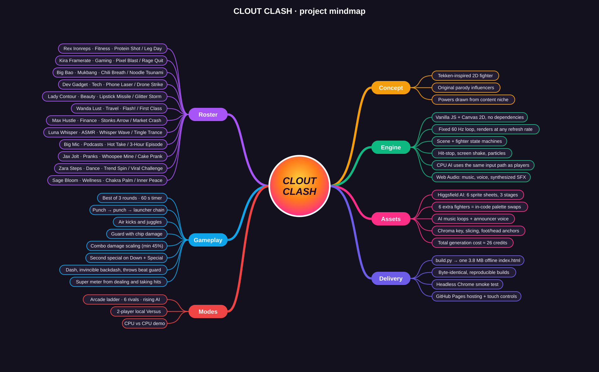
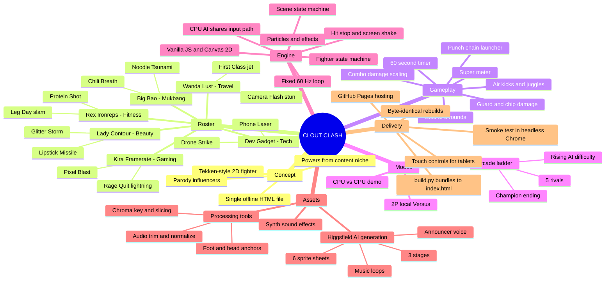
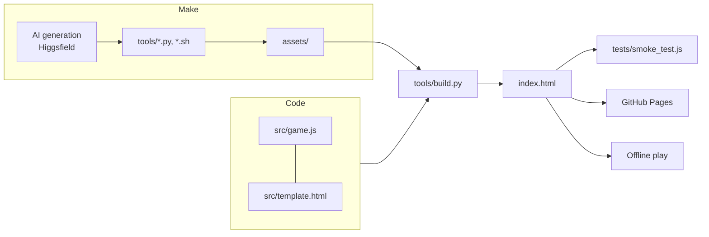

# CLOUT CLASH: project mindmap

A one-page map of the whole project: what the game is, how it plays, how it's built, and how it ships.

*Image generated by [`tools/make_mindmap.py`](../tools/make_mindmap.py). Edit the tree there and re-run it to update.*

Interactive Mermaid version (GitHub renders this natively)

## How the pieces connect

